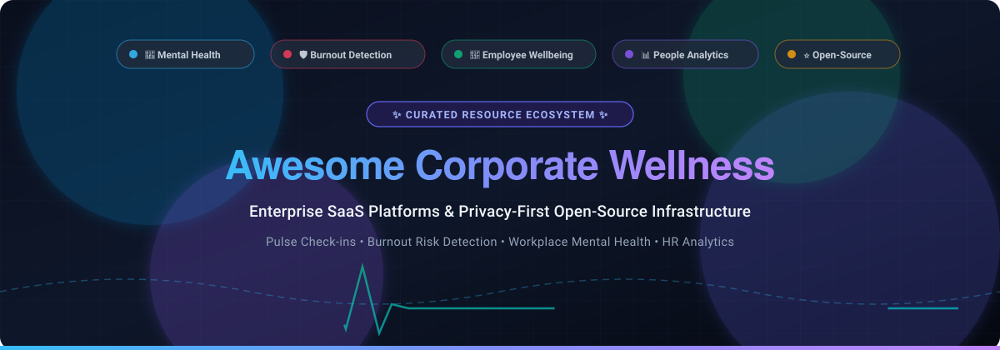

# Awesome Corporate Wellness 🌿

  

  
  
  
  
  
  

  <strong>🌟 Top Corporate Wellness Platforms &amp; Open-Source Projects 🌟</strong> 
  <em>A curated directory of SaaS platforms, tools, and open-source software for employee wellbeing check-ins, mental health support, burnout risk prevention, and workplace people analytics.</em>

---

## 📌 Overview &amp; Key Features

This repository tracks notable **enterprise SaaS solutions** and **open-source repositories** designed for modern **Corporate Wellness**, **Employee Mental Health**, and **Workforce Resilience**. These tools empower people ops leaders, HR practitioners, and engineering teams to:
- 🩺 **Conduct Employee Wellbeing Check-ins**: Measure team mood, stress levels, work-life balance, and connection.
- 🛡️ **Detect &amp; Prevent Burnout Risk**: Leverage early behavioral indicators, sentiment analysis, and pulse metrics.
- 🧠 **Provide Mental Health &amp; Psychological Support**: Facilitate anonymous counseling, mindfulness exercises, and therapy access.
- 📊 **Deliver Actionable People Analytics**: Provide management with high-level anonymized wellness dashboards with strict privacy thresholds.
- 🔒 **Enable Self-Hosted Data Sovereignty**: Deploy open-source, on-premise wellness infrastructure ensuring employee health data stays private and compliant.

> **Last Updated:** October 2026 • Contributions are warmly welcomed! 🤝

---

## 📑 Table of Contents

- [📈 Sector Overview & Market Dynamics](#-sector-overview--market-dynamics)
- [🏢 SaaS / Hosted Enterprise Platforms](#-saas--hosted-enterprise-platforms)
- [💻 Open-Source GitHub Projects](#-open-source-github-projects)
  - [⭐ Featured Open-Source Repositories (Ranked by Stars)](#-featured-open-source-repositories-ranked-by-stars)
  - [📦 Additional Open-Source Solutions & Tools](#-additional-open-source-solutions--tools)
- [🤝 How to Contribute](#-how-to-contribute)
- [💖 Support & Community](#-support--community)
- [📊 Star History](#-star-history)
- [⚠️ Disclaimer & Security Considerations](#-disclaimer--security-considerations)

---

## 📈 Sector Overview & Market Dynamics

The global corporate wellness market is valued between **$55B and $76B** (projected to reach over $100B by 2030 at ~7–9% CAGR), driven by preventive digital health, remote workplace ergonomics, and corporate mental health investments. The industry is currently **moderately fragmented**—with no single leader controlling more than 10% market share and the top 10 providers capturing 35–40%—though it is rapidly consolidating through M&A as enterprise buyers migrate away from point solutions toward unified, all-in-one health and benefits platforms.

---

## 🏢 SaaS / Hosted Enterprise Platforms

| Platform | Company Size (Valuation / Revenue) | Pricing (Starting Tiers) | Free Tier / Trial Limits | Key Capabilities & Best For |
| :--- | :--- | :--- | :--- | :--- |
| **[Workday Wellness](https://www.workday.com/)** | **~$52B Market Cap** (~$8.4B–$10B ARR) | Core HCM suite starts at **~$3–$8/employee/month** at scale ($35–$100/employee/year; Wellness module quoted as enterprise add-on) | **No perpetual free tier**; enterprise sales demo & custom sandbox environments available upon RFP qualification | Best for Workday enterprise customers seeking integrated benefits administration and unified HR data. |
| **[Lyra Health](https://www.lyrahealth.com/)** | **~$5.6B Valuation** (Series F) | Starting tiers structured via clinical baseline models at **~$3–$10 PEPM** (utilization & value-based outcomes models) | **No perpetual free tier**; structured prospective client evaluation demos with no public self-service sandbox | Comprehensive clinical mental health, therapist networks, digital coaching, and outcome-guaranteed enterprise care. |
| **[Spring Health](https://www.springhealth.com/)** | **~$3.3B Valuation** (Series E) | Bundled enterprise mental health starting tiers at **~$3–$10 PEPM** based on workforce size & coverage scope | **No perpetual free tier**; enterprise sales demo & clinical ROI consultation with no direct self-serve trial | Precision mental health, clinical navigation, employee therapy sessions, and psychiatric medication management. |
| **[Virgin Pulse](https://www.virginpulse.com/)** *(Personify Health)* | **~$3.0B Valuation** (~$500M ARR post-merger) | Starting enterprise packages at **~$3–$6 PEPM** (typical annual minimum commitments start at ~$15,000–$18,000/year) | **No perpetual free tier**; sales-guided interactive partner portal demo and pilot scoping (no public self-serve trial) | Large employers seeking holistic engagement, physical activity rewards, social challenges, and health benefits navigation. |
| **[Wellhub](https://wellhub.com/)** *(Gympass)* | **~$2.4B Valuation** (Series F) | Employer corporate baseline access fee starts at **$1.00/employee/month** (Premium packages from $10–$50 PEPM; employee gym tiers separate) | **No perpetual free tier**; employer pilot walkthroughs available on request (requires corporate email domain) | Subsidized global gym, fitness studio, and digital wellness app networks for distributed workforces. |
| **[Calm for Business](https://www.calm.com/business)** | **~$2.0B Valuation** (~$200M–$210M ARR) | Starting self-serve business tiers at **~$60–$70/employee/year** (~$5.00–$5.83/seat/month, min. 5 seats billed annually) | **Perpetual consumer free tier** (limited rotating meditations, 1 breathing exercise; business admin portal has 0 free days / demo-only) | Turnkey self-guided mindfulness, sleep stories, guided breathing, and workplace stress reduction. |
| **[Headspace for Work](https://www.headspace.com/work)** | **~$300M Acquisition** (~$200M ARR) | Core mindfulness tiers start at **$12–$36/employee/year** ($1–$3/seat/month for 100+ seats; clinical coaching at $3–$12 PEPM) | **14-day free trial** with full library access on consumer accounts (business tiers evaluated via consultative sales pilot) | Evidence-based mindfulness sessions, mood check-ins, focus music, and integrated behavioral health coaching. |
| **[WebMD Health Services](https://www.webmdhealthservices.com/)** | **Sub-division of KKR / WebMD** (~$75M Limeade acquisition) | Digital-only wellness starting tiers at **~$3–$8 PEPM** (full-service clinical/coaching packages start at $8–$15+ PEPM) | **No perpetual free tier**; guided platform demonstration and organizational pilot scoping via sales consultants | Clinically oriented population health management, biometric screening integration, and chronic condition support. |
| **[Limeade](https://www.limeade.com/)** *(WebMD ONE)* | **$75M Acquisition Price** (~$56M annual revenue) | Employee listening and wellbeing suites start at **~$3–$7 PEPM** (minimum employee headcount thresholds apply) | **No perpetual free tier**; custom employer demo of TINYpulse and Limeade Well-Being suites upon request | Holistic employee engagement, organizational inclusion, pulse survey analytics, and well-being habit tracking. |
| **[Wellable](https://www.wellable.co/)** | **~$22M–$26M ARR** (Private Growth Stage) | *Essentials* tier starts at **$4.00/user/month** ($100/mo platform minimum; *Pro* tier starts at $6.00/user/month) | **No perpetual free tier**; interactive product tours and personalized 1-on-1 team demonstrations on request | Mid-market structured wellness challenges, customizable rewards programs, and wearable health tracker syncing. |

---

## 💻 Open-Source GitHub Projects

> [!NOTE] 
> Dedicated open-source corporate wellness platforms are early-stage compared to enterprise SaaS. Most projects are focused on pulse surveys, anonymous psychological support, sentiment analytics, or diagnostic burnout risk modeling. Repositories below are equipped with live social Stars_Badges and sorted by Stars_Count in descending order.

### ⭐ Featured Open-Source Repositories (Ranked by Stars)

1. **[NLP Sentiment Analysis for Internal Communications](https://github.com/Okes2024/NLP-for-Sentiment-Analysis-in-Internal-Communications)** 
   - **Overview:** Uses Natural Language Processing (NLP) to perform sentiment analysis on team communications and survey feedback, helping organizations gauge employee mood, detect morale shifts, and surface workplace engagement blockers.
   - **Tech Stack:** Python, NLP, Sentiment Transformers.
   - **Best For:** HR analytics teams wanting automated, data-driven mood and sentiment extraction from feedback channels.

2. **[Employees Burnout Analysis and Prediction](https://github.com/usmanbvp/Employees-Burnout-Analysis-and-Prediction)** 
   - **Overview:** A data science framework and predictive modeling toolkit focused on analyzing work-from-home stress factors, workload volume, mental fatigue scores, and forecasting employee burnout risk.
   - **Tech Stack:** Python, Pandas, Scikit-Learn, Jupyter Notebook.
   - **Best For:** People analytics researchers exploring correlation between remote work fatigue and team attrition.

3. **[Employee Burnout & EX Improvement Agent Skill](https://github.com/dungnotnull/employee-burnout-ex-improvement-agent-skill)** 
   - **Overview:** Production-grade organizational psychology harness auditing workplace exhaustion against Maslach Burnout Inventory (MBI) and Job Demands-Resources (JD-R) models with privacy-preserving collection pipelines.
   - **Tech Stack:** Python, Crawl4AI, Organizational Psychology MBI Evaluation Framework.
   - **Best For:** Engineering and HR teams wanting automated organizational psychology audits without violating employee privacy.

4. **[BurnoutShield](https://github.com/its-crazy4u/burnoutshield)** 
   - **Overview:** Privacy-first desktop application detecting employee burnout risk in real time using passive keystroke and mouse behavioral AI metrics, based on published academic research.
   - **Tech Stack:** Python, Behavioral Analytics, Desktop UI.
   - **Best For:** Organizations exploring non-intrusive, edge-computed burnout warning signals.

5. **[AI-Workforce-Wellbeing](https://github.com/raimegha630/AI-Workforce-Wellbeing)** 
   - **Overview:** AI-powered workplace analytics platform monitoring team productivity and wellbeing using sentiment analysis and interactive Streamlit data visualizations for quick insights into stress trends.
   - **Tech Stack:** Python, Streamlit, NLP Sentiment Analysis.
   - **Best For:** Small business managers wanting a self-hosted dashboard for monitoring collective team stress patterns.

6. **[StaffPulse](https://github.com/SK3CHI3/STAFF_PULSE)** 
   - **Overview:** WhatsApp-based AI HR tool helping distributed teams track employee mood, detect burnout, and enhance workplace culture through automated weekly check-ins and real-time sentiment dashboards.
   - **Tech Stack:** Node.js / Python, WhatsApp Business API, Sentiment Dashboards.
   - **Best For:** Mobile-first or frontline teams needing zero-friction check-ins via chat apps.

7. **[ServiceNow Employee Wellness Hub](https://github.com/10DownPro/servicenow-employee-wellness-hub)** 
   - **Overview:** Scoped ServiceNow application managing employee wellness check-ins, coaching sessions, and mental health resources with enterprise-grade role-based access controls and compliance safeguards.
   - **Tech Stack:** ServiceNow Scoped App, JavaScript, Flow Designer.
   - **Best For:** Enterprise enterprises already running ServiceNow who desire internal wellness tracking within their existing IT/HR portal.

8. **[Project PulseIQ](https://github.com/K-Tejaswi8/Project-PulseIQ)** 
   - **Overview:** Workforce analytics dashboard tracking employee burnout, attrition risk, and engagement across departments via stress/overtime heatmaps and predictive health forecasting.
   - **Tech Stack:** Power BI, DAX, Advanced Workforce Data Models.
   - **Best For:** People ops leaders looking for executive-ready burnout heatmaps and attrition correlations.

9. **[WellMo](https://github.com/DKeen0123/WellMo)** 
   - **Overview:** Lightweight, test-driven wellbeing check-in application built with ReactJS for logging personal wellness and team sentiment.
   - **Tech Stack:** React, JavaScript, Jest/TDD.
   - **Best For:** Engineering teams looking for a clean, test-driven React template for mood logging.

10. **[Mental Health Check](https://github.com/shamkaushal10-svg/mental-health-check)** 
    - **Overview:** Private, browser-based mental wellbeing check-in tool calculating an index score out of 100 based on standard psychological wellness questions.
    - **Tech Stack:** HTML5, CSS3, JavaScript.
    - **Best For:** Individuals or teams wanting an instant, zero-backend self-assessment utility.

11. **[WorkMate](https://github.com/karlis0099/WorkMate)** 
    - **Overview:** A weekly 7-dimension psychological check-in system (mood, energy, motivation, stress, work-life balance, connection, accomplishment) featuring composite scores, burnout risk Slack/Teams webhooks, and manager analytics.
    - **Tech Stack:** Java, SQLite, Local Web UI.
    - **Best For:** Small internal teams wanting a private, self-hosted weekly check-in server with webhook notifications.

12. **[MindBridge](https://github.com/guopanqi/mindbridge)** 
    - **Overview:** Privacy-architected anonymous employee psychological support system featuring AES-GCM encrypted counseling, crisis detection rules, and hardcoded HR aggregation thresholds (hidden when sample size < 10).
    - **Tech Stack:** Cloudflare Pages/Workers, D1 database, DingTalk Bot.
    - **Best For:** Organizations prioritizing end-to-end cryptographic privacy and counselor-managed workflows.

13. **[AI Wellness Hub](https://github.com/Saikumar1801/AI-Wellness-Hub)** 
    - **Overview:** Dual-AI workplace mental health system combining an XGBoost predictive treatment-likelihood model, SHAP factor explainability, and a Gemini-powered advisor with safety hotline fallback protocols.
    - **Tech Stack:** Python, Streamlit, XGBoost, SHAP, Google Gemini API.
    - **Best For:** HR data scientists seeking a reference prototype for explainable AI wellness diagnostics.

14. **[Impulse Wellness Platform (Move On)](https://github.com/Matheussoranco/Unified_industrial_HR_System)** 
    - **Overview:** Comprehensive corporate wellness frontend prototype covering physical, mental, and nutritional health tracking, corporate rankings, and leaderboards.
    - **Tech Stack:** React, TypeScript, Tailwind CSS.
    - **Best For:** UI/UX developers seeking a full-featured wellness platform interface to adapt.

---

### 📦 Additional Open-Source Solutions & Tools

- **[Sentio](https://hub.docker.com/r/padi2312/sentio)** — Lightweight, privacy-conscious daily team mood tracker modeled on the Niko-Niko calendar with Docker Compose deployment, anonymous modes, and recurring calendar reminders.
- **Reflect (Microsoft Teams)** — Custom Teams message extension (MIT) enabling employees to share emotional wellbeing states directly inside Microsoft Teams channels or privately with managers.

---

## 🤝 How to Contribute

Contributions are welcome! Please follow these guidelines:
1. 🍴 Fork the repository.
2. 🌿 Create a new feature branch (`git checkout -b feature/wellness-tool`).
3. 📝 Add your tool with factual descriptions, active links, and pricing details.
4. 🚀 Submit a Pull Request with a clear summary of your additions.

---

## 💖 Support & Community

If you find this curated list valuable for your organization, research, or personal wellness projects, please consider supporting the project:

- ⭐ **Star this repository** to help others discover these resources!
- 🍴 **Fork & Share** with your colleagues, HR leaders, and developer communities.
- 💬 **Join our Discord Community**: [Chat with contributors on Discord](https://discord.gg/jc4xtF58Ve)
- ☕ **Sponsor & Buy a Coffee**: If you'd like to back ongoing open-source maintenance, visit the [GitHub Sponsor Dashboard](https://github.com/sponsors/ishandutta2007). Your support helps keep this directory actively maintained!

---

## 📊 Star History

---

## ⚠️ Disclaimer & Security Considerations

- This repository is a **community-curated index** for informational and educational purposes; inclusion does not constitute a clinical or corporate endorsement.
- Corporate wellness tools handling employee health and psychological data must comply with relevant data protection statutes (**HIPAA**, **GDPR**, **CCPA**, etc.) and enforce strict role-based access control, cryptographic isolation, and aggregate reporting limits.
- **Pulse Check-ins vs. Clinical Care**: Mood trackers (e.g., WorkMate, Sentio) measure sentiment trends, whereas enterprise platforms (e.g., Spring Health, Lyra Health) deliver licensed clinical therapy. Do not substitute self-serve tracking for professional psychological care.
- Open-source implementations should be audited for multi-tenancy, authentication security, and database encryption prior to deployment in production environments.

---

  Made with ❤️ for HR teams, engineering managers, and organizations building transparent, human-centered workplaces.

